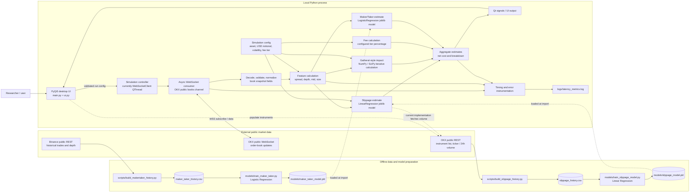
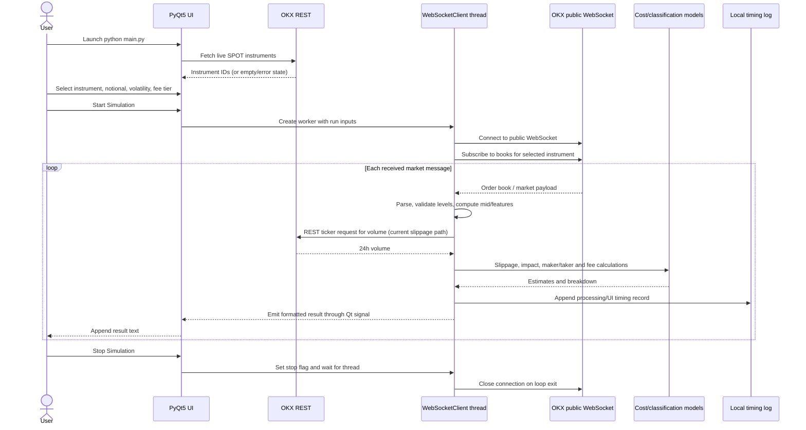
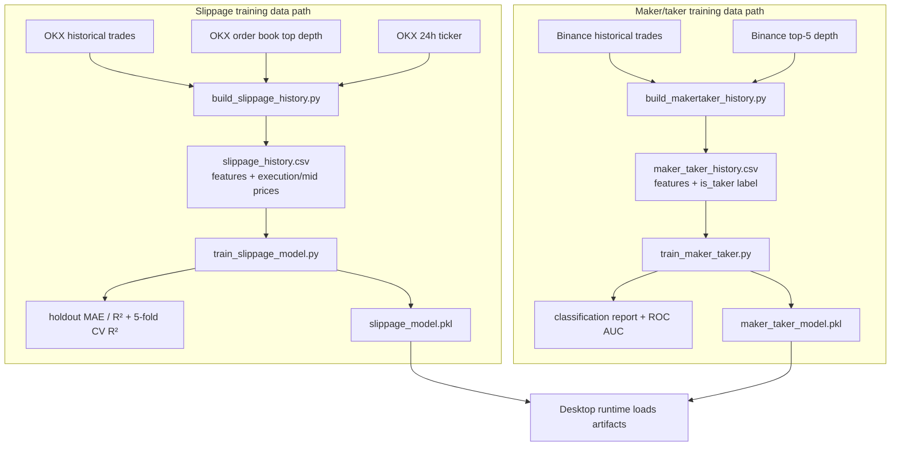
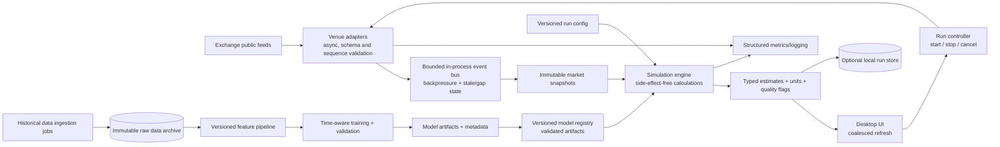

# Veloz — Comprehensive System Design

> Repository-grounded architecture and end-to-end workflows for **Veloz: High-Performance Trading Simulator**. This document distinguishes the implementation currently present in the repository from the recommended production-grade evolution. Veloz is a market-data-driven simulation/analytics desktop application; the inspected code does **not** submit orders to an exchange.

## 1. Executive summary

Veloz is a Python 3.11 / PyQt5 desktop application. A user selects an OKX spot instrument, order notional, volatility input and fee tier. A worker thread opens an OKX public WebSocket order-book subscription, processes market messages, calculates estimated slippage, market impact and fees, infers maker/taker classification with a saved logistic-regression model, and sends a text result to the Qt UI. Processing and UI timing are written to a local log.

A separate offline data/model workflow downloads public historical market/trade data from OKX and Binance into CSV files, trains scikit-learn models, and serializes them with joblib. Those artifacts are loaded at module import time by the live simulator.

The current system is a useful local research/demo prototype, but it is not an exchange execution platform or a deterministic high-frequency backtester. The live path mixes asynchronous WebSocket reads with synchronous REST calls, model inference, numerical integration, file logging and per-tick UI rendering. Units and provenance of several model outputs should be validated before interpreting displayed net cost as a reliable dollar estimate.

## 2. Scope and design goals

### Current scope

- Desktop interactive simulation UI.
- Public exchange market-data ingestion (OKX WebSocket and REST in the current flow).
- Per-update market feature extraction and cost estimates.
- Local historical CSV creation and offline ML training.
- Local latency/processing log output.

### Explicit non-goals in the current implementation

- Sending or routing real orders; exchange private APIs, keys, balances and order lifecycle are not present in the inspected live client.
- Multi-user service, hosted API, distributed storage, deployment cluster, or cloud model serving.
- Guaranteed exchange-grade timestamping or microsecond-level low-latency execution.
- A validated historical event-driven backtesting engine with point-in-time market data.

### Design goals for an evolved system

1. Keep market-data capture, simulation calculations, UI and model training loosely coupled.
2. Make every result reproducible from a versioned input snapshot, configuration and model version.
3. Keep the UI responsive and prevent slow network/provider calls from stalling market-data processing.
4. Make units, assumptions, data quality and estimate uncertainty visible.
5. Measure latency with clearly defined clock boundaries and report distributions, not misleading single values.
6. Keep simulation strictly separated from real execution. If live execution is ever added, treat it as a separate, explicitly authorized and independently risk-controlled subsystem.

## 3. High-level architecture chart



**Legend:** Solid paths describe the observed data path; dotted paths denote setup/configuration or model lifecycle relationships. The chart intentionally shows external providers and the offline pipeline separately from the per-tick simulation path.

## 4. Component inventory

| Component | Current responsibility | Repository location / technology |
|---|---|---|
| Application entry point | Creates `QApplication`, instantiates the main window and runs the Qt event loop | `main.py`, PyQt5 |
| Desktop UI | Collects instrument, order type, USD quantity, volatility and fee tier; starts/stops a worker; displays emitted text; loads live instrument choices | `ui.py`, PyQt5 widgets |
| Simulation worker | Runs an asyncio event loop inside `QThread`; connects to OKX public WebSocket, subscribes to `books`, parses updates and calculates/display metrics | `websocket_client.py`, `QThread`, `asyncio`, `websockets` |
| Instrument discovery | Fetches live OKX spot instrument IDs through public REST | `websocket_client.fetch_available_assets()` |
| Market-data decoder | Reads first returned book payload; converts bid/ask levels; derives timestamp, mid, trade-side/size fields | `websocket_client.py` |
| Slippage estimator | Builds spread/depth/volume/size features and applies a pre-trained linear regression artifact; fetches 24h volume from OKX REST | `models/slippage.py`, `models/slippage_model.pkl` |
| Market-impact model | Numerical Gatheral-style transient/permanent/risk calculation using a fixed-point iteration and configured parameters | `models/impact.py`, NumPy/SciPy |
| Maker/taker classifier | Computes relative aggressiveness and size/depth ratio; evaluates a logistic-regression probability and thresholds it at 0.5 | `models/maker_taker.py`, `models/maker_taker_model.pkl` |
| Fee estimator | Applies one of three hard-coded percentage rates to USD notional | `utils/fees.py` |
| Latency helper | Converts elapsed wall-clock time to milliseconds | `utils/latency.py` |
| History builders | Fetch exchange trades, book depth and volume; write feature/label CSVs | `scripts/build_slippage_history.py`, `scripts/build_makertaker_history.py` |
| Training jobs | Split CSV data, fit/evaluate scikit-learn models and serialize with joblib | `models/train_slippage_model.py`, `models/train_maker_taker.py` |
| Operational log | Appends formatted per-update timing lines to a local file | `logs/latency_metrics.log` |
| Runtime environment | Python 3.11 with PyQt5, scikit-learn, requests, websockets, pandas, joblib; model code also imports NumPy/SciPy | `environment.yml`, `pip_requirements.txt` (verify consistency) |

## 5. End-to-end user workflow



### Workflow details and current behavior

1. `main.py` starts the Qt event loop and opens `TradeSimulatorUI`.
2. UI initialization calls `fetch_available_assets()`. A failed request results in a fallback display string rather than a usable instrument list.
3. Start Simulation first stops a previous worker, reads the current widget values, constructs `WebSocketClient`, and connects its `tick_signal` to the output text box.
4. The worker starts an asyncio loop in its Qt thread, connects to `wss://ws.okx.com:8443/ws/v5/public`, and subscribes to the selected `books` instrument.
5. Each received JSON message is parsed; book levels are converted to floats and invalid/empty books are skipped.
6. The code computes a mid-price from averages of the first five bid and ask prices; calls slippage, fee, impact and maker/taker calculations; sums slippage + impact + fee; formats a string; emits it to the UI; and logs timing.
7. On errors the client emits an error string and, for connection-level failures, sleeps and reconnects. Stop toggles a boolean; connection cleanup relies on the current await/connection scope ending.

## 6. End-to-end offline data and model workflow



1. The slippage builder currently collects OKX BTC-USDT history in batches, fetches top-of-book levels and 24-hour volume, then writes rows to CSV.
2. The maker/taker builder currently collects Binance BTCUSDT trades and top-five book depth, derives a label from the exchange trade's buyer-maker flag, then writes a CSV.
3. The training scripts engineer features, use a random train/test split, fit linear/logistic regression, print metrics and serialize models.
4. The runtime loads model files once during Python module import. Training does not appear to be a runtime or automated deployment step.
5. To reproduce a run, the current artifact files and the input datasets need to be retained and tied to the code/config version. A model file alone is insufficient provenance.

## 7. Data contracts and financial units

### Market snapshot (recommended normalized internal contract)

```text
MarketSnapshot {
  venue: string                 # e.g. OKX
  instrument: string            # venue-native ID, e.g. BTC-USDT
  venue_event_time_ns: int?     # source event timestamp if available
  receive_time_monotonic_ns: int
  receive_time_utc: timestamp
  sequence_id: string?          # exchange sequence/checksum if available
  bids: list<(price, base_qty)>
  asks: list<(price, base_qty)>
  last_trade_price: decimal?
  last_trade_side: buy|sell|unknown
  last_trade_qty: decimal?
  data_validity: valid|stale|gap|invalid
}
```

A book update must be distinguished from a full snapshot vs incremental delta. The current implementation reads the first `data` element and treats its bid/ask arrays as a usable book; confirm the OKX channel semantics and book-maintenance requirements before relying on deeper levels or continuity.

### Simulation run configuration

```text
SimulationConfig {
  run_id: UUID
  instrument: string
  venue: string
  order_notional_usd: decimal
  volatility: decimal
  volatility_unit: explicit (e.g. annualized decimal)
  fee_tier: configured tier / schedule version
  order_side: buy|sell
  order_type: market|limit (only if implemented)
  execution_horizon_seconds: decimal
  model_versions: { slippage, maker_taker, impact_parameters }
  started_at_utc: timestamp
}
```

The UI currently exposes an `Order Type` text field with default `Market`, but the value is not passed into the `WebSocketClient` constructor or used in the shown calculation path. Until implemented, do not imply that different order types alter execution simulation.

### Estimate output

```text
SimulationEstimate {
  run_id: UUID
  market_snapshot_id: string
  slippage_value: decimal
  slippage_unit: USD | fraction | bps
  impact_total_usd: decimal
  impact_transient_usd: decimal
  impact_permanent_usd: decimal
  impact_risk_usd: decimal
  fee_usd: decimal
  net_cost_usd: decimal
  maker_probability: decimal?
  maker_taker_label: Maker|Taker|Unknown
  confidence_or_applicability: optional metadata
  calculation_duration_ns: int
}
```

**Unit invariant:** all terms must be converted to the same currency/notional unit before calculating `net_cost`. The training target in `train_slippage_model.py` is relative slippage `(exec_price - mid_price_at_submit) / mid_price_at_submit`, while the live UI labels the model result simply as `Slippage` and adds it to impact and fee values. Verify this unit conversion and sign convention before calling the sum a dollar net cost. A relative return must be converted to USD notional or shown in basis points, not added directly to USD.

## 8. Model and calculation responsibilities

### Slippage regression

- **Training features:** spread, top-five depth, 24-hour volume and order size.
- **Training label:** relative price difference using execution price and mid-price-at-submit.
- **Live features:** normalized spread `(best ask - best bid) / mid`, combined top-five depth, OKX 24h volume, and USD notional.
- **Artifact:** `models/slippage_model.pkl` loaded using joblib at import.
- **Review points:** ensure feature definitions/units and market venues match training; validate against time-ordered holdout data and unseen regimes; define behavior for out-of-range feature values and missing volume; record model version and uncertainty.

### Maker/taker classifier

- **Training features:** relative aggressiveness and trade-size/top-five-depth ratio.
- **Label:** exchange trade buyer-maker indicator in the historical Binance data.
- **Live inputs:** market payload `lastPx`, `side` and `sz` fields paired with the currently subscribed book.
- **Output:** probability thresholded at 0.5 to a binary maker/taker label.
- **Review points:** the current market message trade fields are not necessarily the user's hypothetical order/fill; ensure the result is named as inferred market-trade classification unless a simulated order/fill is modeled. Train/test split should be time-aware to avoid temporal leakage, and probabilities should be calibrated if interpreted quantitatively.

### Market impact calculation

- The code uses a Gatheral-style transient-impact kernel, a discretized trading horizon, damped fixed-point iterations, and transient/permanent/risk components.
- Current parameters in the worker include `delta`, `gamma`, `lam`, `T` and `N`; volatility comes from the UI.
- `calculate_impact` receives a single `orderbook` argument but the implementation assigns prices from the same first five levels to local `bids` and `asks` arrays. The call site passes `asks`. Review the intended mid-price/book inputs and theoretical derivation before relying on output.
- The nested loop/iteration is computationally expensive relative to a simple linear estimate. Profile it, validate convergence and guard non-finite/zero inputs; consider a separately benchmarked vectorized/compiled implementation if scale requires.

### Fee estimate

- Current implementation maps `Tier 1`, `Tier 2`, `Tier 3` to fixed rates and multiplies by USD notional.
- This is a simplified simulation assumption, not a confirmed current exchange fee schedule. Label as configurable assumed fee; version schedules and distinguish maker/taker rates if the feature intends to model them.

## 9. Performance design and latency measurement

The project aims at high performance, but the measured values should be interpreted as desktop application timing rather than exchange-network or execution latency.

### Current timing behavior

- The receive path captures `start_recv` immediately before awaiting `ws.recv()` and measures elapsed wall-clock time after the await. This is message wait/receive duration from the local call boundary, not one-way network latency.
- The code records a timestamp before awaiting the receive, so `_arrival_times` is based on time immediately before each receive wait rather than precisely timestamped message arrivals.
- `time.time()` is used for one timing helper; wall clocks can jump. Use monotonic clocks for durations.
- Processing includes JSON parsing, REST volume fetch through `requests`, synchronous ML inference, numerical impact iteration, string formatting and signal emission. These should be reported as separate spans.
- UI emission timing measures the emit call, not the time the Qt event loop actually paints the update.
- Synchronous `requests.get` from the worker's asyncio loop blocks that loop. The per-update REST ticker call can dominate throughput and can be rate-limited.
- The GUI appends verbose text on each market update; UI rendering and file logging can become bottlenecks.

### Recommended measurement boundaries

Capture `venue_event_time`, local `receive_monotonic_time`, `decode_start/end`, `feature_start/end`, each model start/end, `ui_emit_time`, and optionally `ui_render_ack_time`. Report p50/p90/p95/p99/max and sample count per stage. Do not call receive-to-process duration “network latency” without clock synchronization and a defined method.

### Recommended performance architecture

1. Maintain one nonblocking async market-data loop whose only critical job is receiving, validating and timestamping updates.
2. Fetch static/slow metadata (24h volume, instrument info, fee assumptions) on a timer or cache it with explicit age; do not make a synchronous REST request for every book update.
3. Use a bounded queue between ingestion and calculation. Define whether overload drops intermediate snapshots, coalesces to latest book, or records every update; expose dropped/stale counters.
4. Separate expensive impact calculation from the GUI thread. If calculation is parallelized, preserve snapshot/config pairing and avoid unbounded work queues.
5. Coalesce UI updates to a fixed refresh rate (for example 5–20 Hz) while preserving the full metric stream separately if needed.
6. Use structured, asynchronous/buffered logging; rotate files and make logging failure non-fatal.
7. On reconnect, resubscribe, verify a fresh book snapshot/sequence, and mark data stale until valid state is restored.
8. Benchmark with deterministic recorded messages and fixed model artifacts; compare end-to-end throughput, CPU, memory, queue depth and tail latency.

## 10. Failure modes and recovery

| Failure | Current/expected behavior | Recommended handling |
|---|---|---|
| Instrument discovery REST unavailable | UI may show “Failed to load assets” | Retry with backoff, allow manual valid instrument entry, show clear connectivity state. |
| WebSocket connect/drop | Error signal and approximately 2-second retry loop | Exponential backoff with jitter, max/recoverable state, resubscription, stale-data indicator and graceful stop cancellation. |
| Malformed/empty book update | Most parsing/validation errors are skipped | Count malformed messages, validate schema, preserve last valid snapshot but mark it stale; alert if sequence gaps. |
| Ticker REST timeout/429 | Slippage estimate raises into outer processing exception | Cache/refresh ticker data separately; use bounded retries and explicit missing/stale volume fallback. Never silently substitute zero without a quality flag. |
| Model artifact missing/incompatible | Import-time `joblib.load` may prevent application startup | Validate artifacts at startup with readable diagnostics; provide version/schema checks and fail closed for affected metric. Never unpickle untrusted artifacts. |
| Numeric instability/non-finite values | Some zero-division paths have a special fallback; others may propagate | Validate positivity/ranges, finite outputs and convergence; return metric-specific unavailable reason instead of fabricated cost. |
| UI overload | Text output may accumulate | Bounded display buffer and coalescing; persist full run data separately only when requested. |
| Stop while blocked | Stop flag is checked between awaits; `wait()` can block until the worker yields | Close/cancel socket from a thread-safe cancellation path, use bounded waits and always close resources in `finally`. |
| Log filesystem issue | Logging may fail or disk can fill | Rotation, retention, disk-space monitoring and graceful fallback to console/no-op. |
| Provider throttling/schema change | APIs can throttle or change payloads | Adapter layer, schema tests, rate limits, provider health and fixture-based contract tests. |

## 11. Security and operational boundaries

The observed code uses public market-data endpoints and no exchange trading credentials. Keep that boundary explicit.

- Do not add exchange API keys to this desktop client for a simulation-only feature. Public feed access should remain read-only.
- If a future feature submits orders, make it a separately reviewed service with explicit opt-in, least-privilege keys, withdrawal disabled, strict risk limits, kill switch, audit logging and independent authorization. Do not treat this architecture as authorization to trade.
- Validate user input: instrument identifier, positive finite notional, bounded volatility, supported fee tier, and numeric precision.
- Treat live market-data messages and downloaded CSVs as untrusted input. Validate shape, ranges, timestamps and file sizes.
- Pin and audit dependencies; do not load pickle/joblib files from untrusted sources, since deserialization can execute code.
- Avoid logging API credentials, private account data or full payloads if private endpoints are introduced.
- Respect exchange API terms, limits and data-use requirements; do not use scraping or polling patterns that exceed public API policy.
- Document data provenance and licensing/retention for historical market data.

## 12. Storage and reproducibility

### Current storage

- Historical feature/label datasets are local CSV files at repository root.
- Trained model artifacts are local joblib/pickle files in `models/`.
- Operational timing is in a local `logs/latency_metrics.log` file.
- The live run output appears in the UI text widget; a structured per-tick results dataset is not evident in the inspected flow.

### Recommended run record

Persist an optional local run bundle containing:

- Run ID, UTC start/end time, app commit/version, Python/dependency versions.
- Instrument and venue, parameter/config values, fee assumptions and unit declarations.
- Data source and model artifact hashes/versions; training dataset window and evaluation metrics.
- Market snapshot/event timestamps, calculated feature values, outputs, validation flags and stage durations.
- Connection gaps, stale periods, dropped/coalesced updates and error records.

Use a documented schema (Parquet/Arrow or SQLite for local analytics; CSV for simple export). Use append-only records for auditability and never describe simulated results as actual execution outcomes.

## 13. Testing and validation plan

### Unit tests

- Fee tier mapping and unsupported tier handling.
- Mid/spread/depth calculations for normal, crossed, empty and malformed books.
- Slippage feature transformation and output unit conversion.
- Maker/taker feature calculations for buy/sell, zero spread and zero depth.
- Impact model finite output, convergence and limiting cases.
- Input validation and UI start/stop state transitions.

### Data/model tests

- Verify training/runtime feature names, order, units and preprocessing are identical.
- Use chronological train/validation/test splits; include instrument/market-regime holdouts.
- Evaluate MAE/RMSE and bias for regression; precision/recall, ROC-AUC and calibration for classifier.
- Track feature drift, out-of-range values and model version/hash.
- Test CSV data quality, duplicate records, missing values and exchange pagination correctness.

### Integration and replay tests

- Mock OKX REST/WebSocket schemas, timeouts, 429s, disconnects, ping/pong and reconnect/resubscribe.
- Replay recorded public order-book messages through the same parser/calculation pipeline.
- Ensure Qt signals are only consumed on the UI thread and the UI remains responsive under a high update rate.
- Test model file missing/corrupt/wrong-version startup cases.
- Test stop/cancel and cleanup during socket wait, REST timeout, and long impact computation.

### Performance and acceptance tests

- Fixed hardware/software baseline; warm-up and multiple runs; report p50/p95/p99, throughput, CPU, memory, queue depth, missed updates and UI render delay.
- Compare model/algorithm outputs against independent reference fixtures.
- Specify an explicit target update rate and allowed dropped/coalesced updates before claiming “high performance.”
- Separate data-provider/network delay from local compute and UI display delay.

## 14. Production-grade target architecture

For larger-scale research or multiple simultaneous simulations, evolve the desktop prototype incrementally rather than introducing unnecessary distributed services immediately:



Recommended package boundaries:

- `domain/`: immutable market snapshot, simulation config and estimate contracts.
- `adapters/okx/`: public REST/WebSocket protocol and exchange-specific decoding.
- `ingestion/`: reconnect, sequence checking, timestamping, rate limits and data quality.
- `simulation/`: slippage, fee, impact and classification interfaces with explicit units.
- `models/`: artifact loading, schema/version validation, inference and training metadata.
- `persistence/`: local run store and raw/feature data formats.
- `ui/`: presentation only; send commands to a run controller and consume typed results.
- `observability/`: structured counters, histograms, traces and privacy-safe logs.

## 15. Prioritized roadmap

### P0 — Correctness and claims
- Define units and convert slippage to USD/bps consistently before aggregating cost.
- Clarify that current `Order Type` UI input is not used in calculations; either wire it into a documented model or remove/disable it.
- Validate Gatheral implementation inputs, especially the single order-book argument used for both bid/ask price arrays.
- Verify maker/taker inference is describing a simulated order rather than the exchange feed's last trade.
- Reconcile runtime and training feature definitions, market venues and date windows.

### P1 — Responsiveness and robustness
- Remove synchronous REST ticker calls from the per-message path; cache/refetch asynchronously.
- Add schema validation, stale book/sequence handling, cancellable shutdown and bounded reconnect policy.
- Bound/coalesce UI rendering and log output; prevent unbounded memory/disk growth.
- Validate model artifacts and numeric inputs/outputs at startup and inference.

### P2 — Reproducibility and model quality
- Version raw data, feature schema, training parameters, artifacts and evaluation reports together.
- Replace random-only splits with chronological evaluation and leakage checks.
- Add deterministic recorded-feed replay and benchmark suite.
- Persist structured optional run bundles with assumptions and quality flags.

### P3 — Scale only when justified
- Separate venue adapters, bounded event bus and calculation workers.
- Profile before native acceleration; optimize the actual dominant stage.
- Add multi-instrument/multi-run orchestration only after defining resource limits and isolation.
- Keep any future real-order execution system separate from the simulator architecture and subject it to independent financial, security and compliance review.

## 16. Repository map and implementation references

- Entry point: [`main.py`](../main.py)
- Desktop input/output and worker lifecycle: [`ui.py`](../ui.py)
- OKX WebSocket, instrument discovery, calculation orchestration and latency logging: [`websocket_client.py`](../websocket_client.py)
- Market impact: [`models/impact.py`](../models/impact.py)
- Slippage inference and artifact loading: [`models/slippage.py`](../models/slippage.py)
- Maker/taker inference and artifact loading: [`models/maker_taker.py`](../models/maker_taker.py)
- Fee and latency utilities: [`utils/fees.py`](../utils/fees.py), [`utils/latency.py`](../utils/latency.py)
- History generation: [`scripts/build_slippage_history.py`](../scripts/build_slippage_history.py), [`scripts/build_makertaker_history.py`](../scripts/build_makertaker_history.py)
- Training workflows: [`models/train_slippage_model.py`](../models/train_slippage_model.py), [`models/train_maker_taker.py`](../models/train_maker_taker.py)
- Environment: [`environment.yml`](../environment.yml), [`pip_requirements.txt`](../pip_requirements.txt)

## 17. Assumptions and limitations

This design is based on the source tree and configuration inspected while writing it. External exchange behavior, the existing PDF documentation, hidden deployment infrastructure, exact production model provenance, API policy, and any uninspected branches were not independently verified. Confirm those before using the document as an operational runbook. The recommendations describe a target architecture, not functionality that is already implemented.
